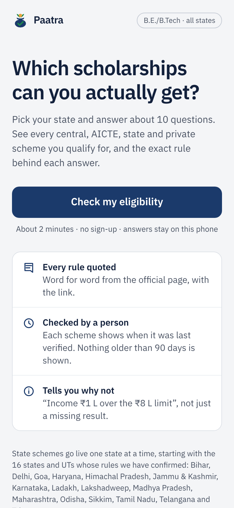
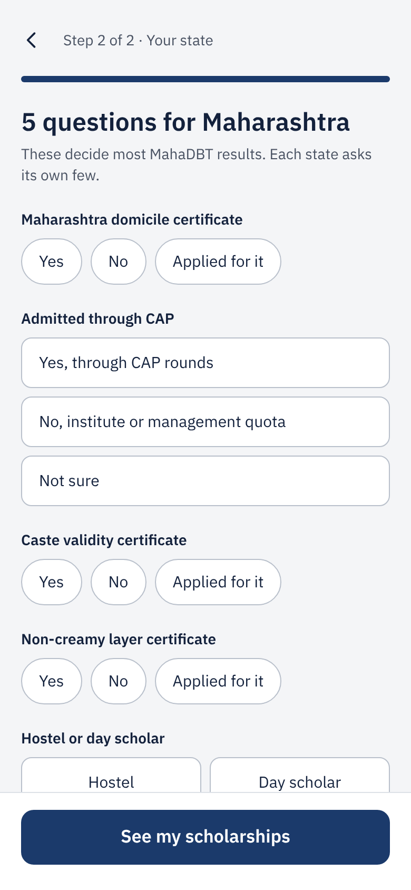
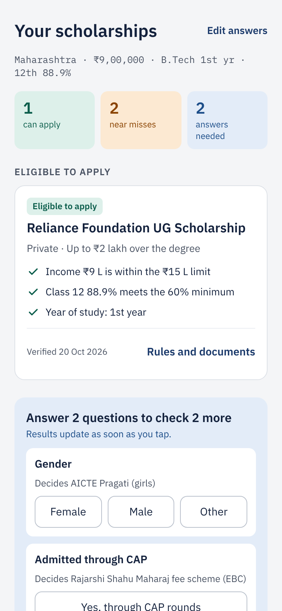
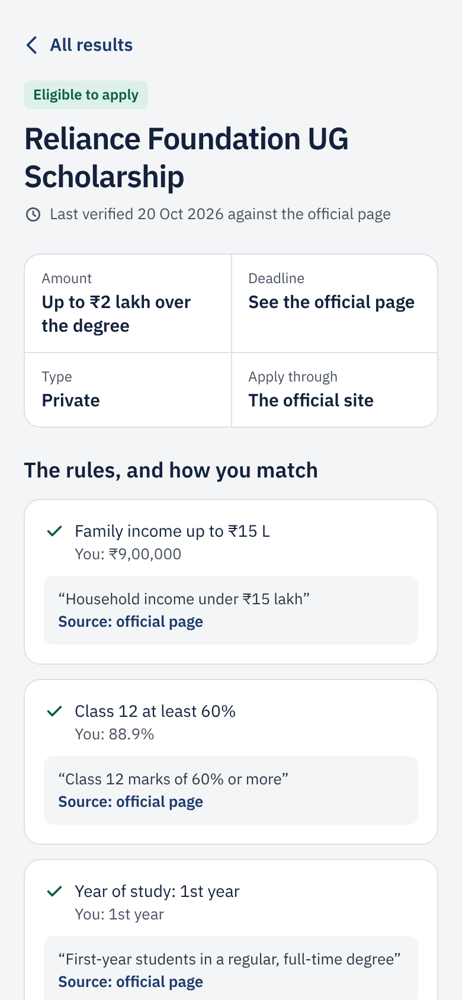
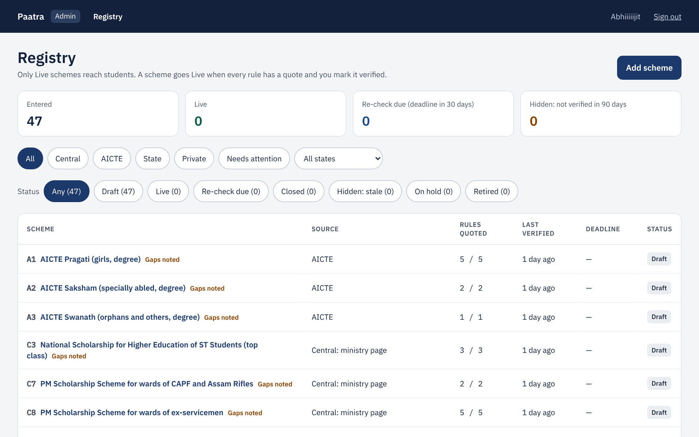
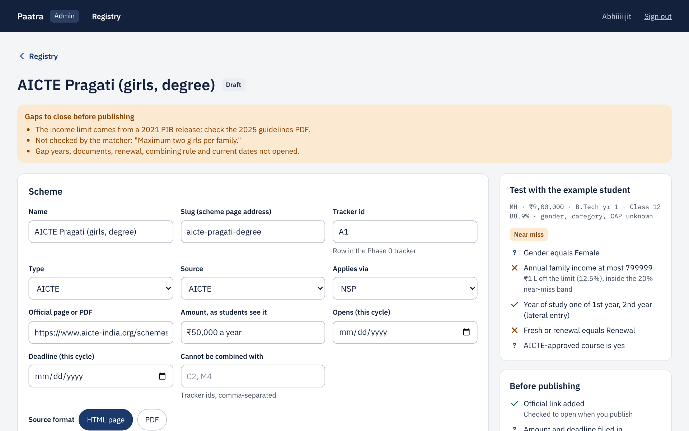
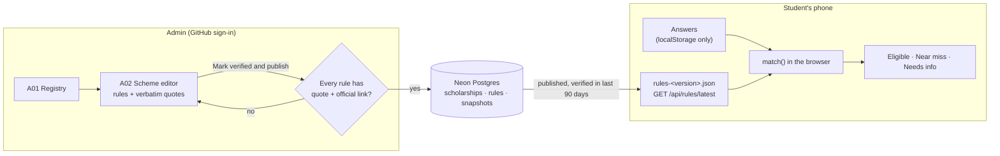
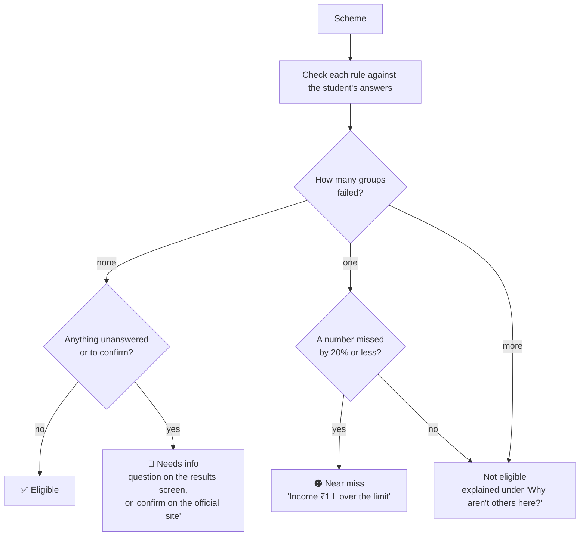

<div align="center">

<picture>
  <source media="(prefers-color-scheme: dark)" srcset="public/brand/logo-tagline-dark.svg">
  
</picture>

**Which scholarships can an Indian B.E./B.Tech student actually get?**<br>
Paatra answers in about two minutes, and quotes the official rule behind every answer.

[](https://scholarship-finder-umber-phi.vercel.app)
[](https://scholarship-finder-umber-phi.vercel.app/admin)

[](https://github.com/Abhiiiiijit/scholarship-finder/actions/workflows/ci.yml)


[Try it](#try-it) · [How it works](#how-it-works) · [Run locally](#run-locally) · [Deploy](#deploy) · [Project docs](#project-docs) · [For AI agents](#for-ai-agents)

</div>

---

## Why Paatra

Scholarship rules for engineering students are spread across NSP, AICTE, 36 state portals and dozens of private trusts, each with its own income limits, categories and fine print. Paatra (पात्र, "eligible") keeps one hand-verified registry and checks a student against all of it at once.

| | |
| --- | --- |
| 📜 **Every rule quoted** | Each rule carries the official wording, word for word, with a link to the page it came from. Nothing is published without one. |
| 🕒 **Checked by a person** | Every scheme shows when it was last verified. Anything older than 90 days is hidden. |
| ❌ **Tells you why not** | "Income ₹1 L over the ₹8 L limit", not just a missing result. Near-misses and missing answers are shown separately. |
| 📱 **Answers stay on the phone** | No sign-up. Matching runs in the browser; the server never sees a student's answers. |

**Coverage today:** B.E./B.Tech students domiciled in 16 states and UTs (Bihar, Delhi, Goa, Haryana, Himachal Pradesh, Jammu & Kashmir, Karnataka, Ladakh, Lakshadweep, Madhya Pradesh, Maharashtra, Odisha, Sikkim, Tamil Nadu, Telangana, Tripura), with central, AICTE, state and private schemes. Students from other states still see every central, AICTE and private scheme.

## Try it

**Live:** [scholarship-finder-umber-phi.vercel.app](https://scholarship-finder-umber-phi.vercel.app). Admin (registry and scheme editor, GitHub sign-in): [/admin](https://scholarship-finder-umber-phi.vercel.app/admin).

<table>
  <tr>
    <td align="center" width="25%"><br><sub><b>1. Start</b><br>No sign-up</sub></td>
    <td align="center" width="25%"><br><sub><b>2. Answer</b><br>Basics, then a few state questions</sub></td>
    <td align="center" width="25%"><br><sub><b>3. Results</b><br>Eligible, near misses, answers needed</sub></td>
    <td align="center" width="25%"><br><sub><b>4. The proof</b><br>Each rule, your answer, the quote</sub></td>
  </tr>
</table>

<sub>Screenshots use the PRD's section 5 worked example (a Maharashtra B.Tech student with ₹9 L family income), not live data.</sub>

**Admin:** one person keeps the scheme registry accurate. Nothing reaches students until every rule carries a quote and a link.

<table>
  <tr>
    <td align="center" width="50%"><br><sub><b>Registry</b><br>Every scheme, what's live, what needs re-checking</sub></td>
    <td align="center" width="50%"><br><sub><b>Scheme editor</b><br>Gaps to close, a live test, then publish</sub></td>
  </tr>
</table>

<sub>Admin screenshots show the Phase 0 schemes loaded as drafts on a local database, not the live registry.</sub>

## How it works



<details>
<summary><b>How a scheme is matched</b></summary>

<br>

Each scheme is a list of rules: `{ group, field, op, value, quote, sourceUrl }`. Rules in the same group are OR-ed, groups are AND-ed. Operators are `EQ`, `IN`, `LTE`, `GTE`, `BETWEEN` and `IS_TRUE`.



- A skipped question is never a "no": it becomes a question on the results screen.
- Optional questions (disability, minority, parent occupation…) unlock hidden schemes: "answer this to check 3 more".
- State schemes match only students domiciled in that state. Each live state asks its own few questions (`src/domain/states.ts`).

</details>

<details>
<summary><b>How a rule gets published</b></summary>

<br>

1. The admin enters the scheme in the editor with each rule's quote copied from the official page.
2. **Mark verified and publish** checks the official URL opens, then refuses any rule without a quote and a link.
3. A deferred Postgres trigger refuses the same thing again at commit, so no code path can publish an unquoted rule.
4. Publishing writes a new, complete snapshot. Students download the latest one; anything not re-verified in 90 days is left out.

</details>

## Stack

| Layer | Choice |
| --- | --- |
| App | Next.js 16 (App Router), React 19, TypeScript, Tailwind CSS 4 |
| Database | PostgreSQL (Docker locally, Neon in production), Drizzle ORM. Rule fields and operators are Postgres enums |
| Rules | Zod schemas in `src/domain/rules`, shared by the admin editor, the snapshot and the matcher |
| Admin sign-in | Auth.js with GitHub, allowlisted logins only |
| Tests | Vitest (registry tests run migrations on in-memory PGlite, no Docker needed); Playwright for the student happy path |
| Hosting | Vercel + Neon free tiers, about $0 a month |

## Run locally

Requires Node.js 22+ and Docker.

```bash
npm install
npm run dev:local   # starts Postgres, applies migrations, runs the app at http://localhost:3000
npm run db:seed     # optional: loads the Phase 0 schemes as drafts
```

No `.env` is needed for local work: the app falls back to the Docker database. To point at Neon instead, copy `.env.example` to `.env` and paste the Neon connection string.

<details>
<summary><b>Develop in the browser (GitHub Codespaces)</b></summary>

<br>

On the repo page, choose **Code → Codespaces → Create codespace on main**. In its terminal, run `npm install && npm run dev:local`, then open the forwarded port 3000. Codespaces includes Docker, so the local database works there unchanged.

</details>

<details>
<summary><b>Admin sign-in</b></summary>

<br>

`/admin` is behind GitHub sign-in (Auth.js) and only lets in the logins in `ADMIN_GITHUB_LOGINS` (default `Abhiiiiijit`).

1. Create a GitHub OAuth app (Settings → Developer settings → OAuth Apps) with callback URL `http://localhost:3000/api/auth/callback/github`.
2. Put its client ID and secret in `.env` as `AUTH_GITHUB_ID` and `AUTH_GITHUB_SECRET`, and add `AUTH_SECRET` from `npx auth secret`.

On Vercel, set the same three variables and add the production callback URL to the OAuth app. Never commit `.env`.

</details>

<details>
<summary><b>Scripts</b></summary>

<br>

| Script | What it does |
| --- | --- |
| `npm run dev:local` | Postgres up, migrations, dev server |
| `npm test` | Unit tests |
| `npm run e2e` | Playwright happy path on a phone viewport (run `npm run build` first; first time: `npx playwright install chromium`) |
| `npm run lint` / `npm run typecheck` | ESLint / TypeScript |
| `npm run build` | Production build (works without a database) |
| `npm run db:generate` | Create a migration after editing `src/server/db/schema.ts`, a rule field or a state question |
| `npm run db:migrate` | Apply migrations |
| `npm run db:studio` | Browse the database |
| `npm run db:seed` | Load the Phase 0 schemes as drafts (skips any already there; `-- --sql` prints the SQL instead) |
| `npm run db:down` | Stop Postgres (data is kept in a Docker volume) |

CI runs lint, typecheck, tests, build and the e2e test on every pull request. Lint also enforces the folder boundaries below (for example, `src/domain` cannot import React or the database).

</details>

<details>
<summary><b>Project layout</b></summary>

<br>

```
src/app/                 student screens (/, /check/*, /results, /scheme/[slug]), admin under /admin,
                         snapshot at /api/rules/latest
src/components/ui/       shared UI from the design's component list
src/domain/rules/        rule schema (operators, publish requirement), rule fields, published snapshot
src/domain/match.ts      match(): eligible / near miss / needs info, runs in the browser
src/domain/profile.ts    the student's answers
src/domain/states.ts     the 16 live states' portals, category lists and state questions
src/domain/registry/     scheme editor input, publish checklist, admin status badges
src/features/registry/   admin views (registry, editor), server actions, labels, Phase 0 seed
src/features/eligibility/ student screens (views), widgets, hooks, on-phone storage,
                         results assembly and plain-language reasons
src/server/              server-only: env check, Drizzle client and schema, repositories,
                         publish service, admin auth
e2e/                     Playwright happy path (serves the PRD section 5 snapshot, no database)
drizzle/                 generated SQL migrations
public/brand/            Paatra logos and mark
```

</details>

## Deploy

<details>
<summary><b>Vercel + Neon, free tiers (step by step)</b></summary>

<br>

1. **App.** Sign in at [vercel.com](https://vercel.com) with GitHub, choose **Add New → Project**, and import `scholarship-finder` (grant Vercel access to the repo if it isn't listed). Keep the detected Next.js settings and click **Deploy**. It builds without a database.
2. **Database.** In the Vercel project, open **Storage → Create Database → Neon**, keep the Free plan, pick the Singapore region, and connect it to the project for all environments. Vercel adds `DATABASE_URL` (pooled) and `DATABASE_URL_UNPOOLED` itself.
3. **Redeploy** from **Deployments → ⋯ → Redeploy** so the app picks up the new variables.
4. **Create the tables.** From your laptop, copy `DATABASE_URL_UNPOOLED` from **Settings → Environment Variables** and run the migrations once:
   ```bash
   DATABASE_URL="<DATABASE_URL_UNPOOLED value>" npm run db:migrate
   ```
   Run this again whenever a PR adds a file under `drizzle/`.
5. **Done.** You get a `*.vercel.app` link. Every push to `main` redeploys it, and every PR gets its own preview link. To use your own subdomain, add it under **Settings → Domains** and create the CNAME record Vercel shows.

A separate Neon account works too: create a project at [neon.com](https://neon.com), copy its pooled connection string into a `DATABASE_URL` variable in Vercel, and use the direct (non-pooler) string for migrations.

For admin sign-in, also set `AUTH_SECRET`, `AUTH_GITHUB_ID` and `AUTH_GITHUB_SECRET` (see Admin sign-in above) and add `https://<your domain>/api/auth/callback/github` to the GitHub OAuth app.

</details>

## Project docs

- [Product requirements (PRD)](https://claude.ai/artifact/UuWcGVMCpGCvRBoVYHSGRi): scope, quoted rules, parameters by state, roadmap, task checklist
- [Screen designs and flow](https://claude.ai/artifact/SoXLK4qi2qy9RPzAuigieR): student screens S01–S09 and admin screens A01–A04

## For AI agents

[`CLAUDE.md`](CLAUDE.md) holds the product context, the rules that must never be broken, and the architecture. Step-by-step skills for common jobs live in [`.claude/skills/`](.claude/skills):

| Skill | For |
| --- | --- |
| [`add-scheme`](.claude/skills/add-scheme/SKILL.md) | Adding or re-verifying a scheme with quoted rules |
| [`add-state`](.claude/skills/add-state/SKILL.md) | Bringing a new state or UT live |
| [`add-rule-field`](.claude/skills/add-rule-field/SKILL.md) | Adding a rule field end to end |
| [`release-checklist`](.claude/skills/release-checklist/SKILL.md) | Shipping a PR or publishing to students safely |
